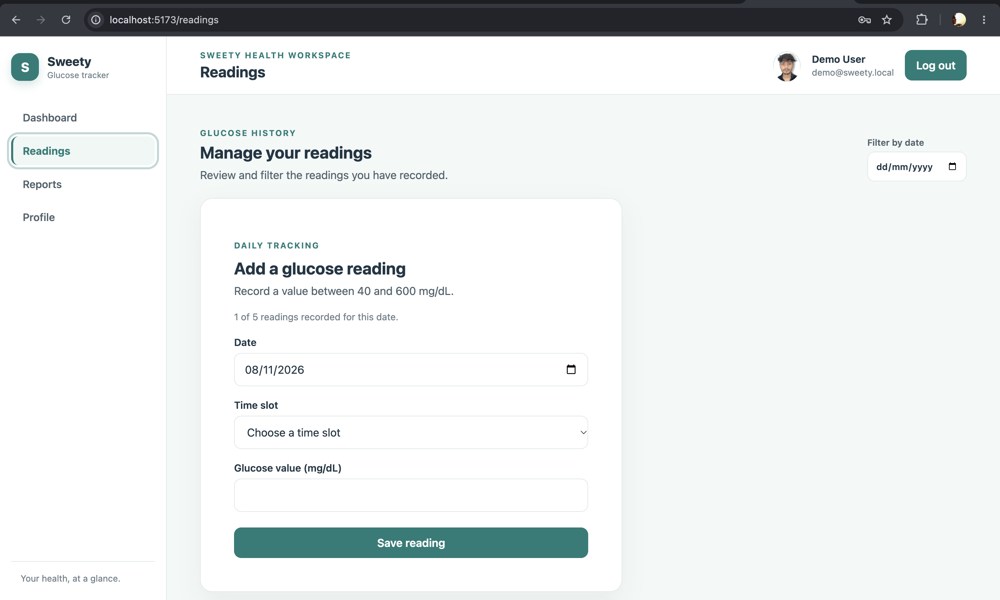
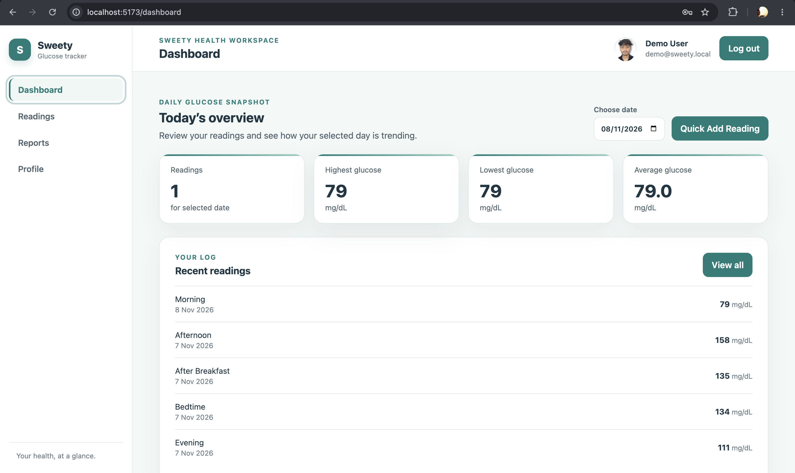
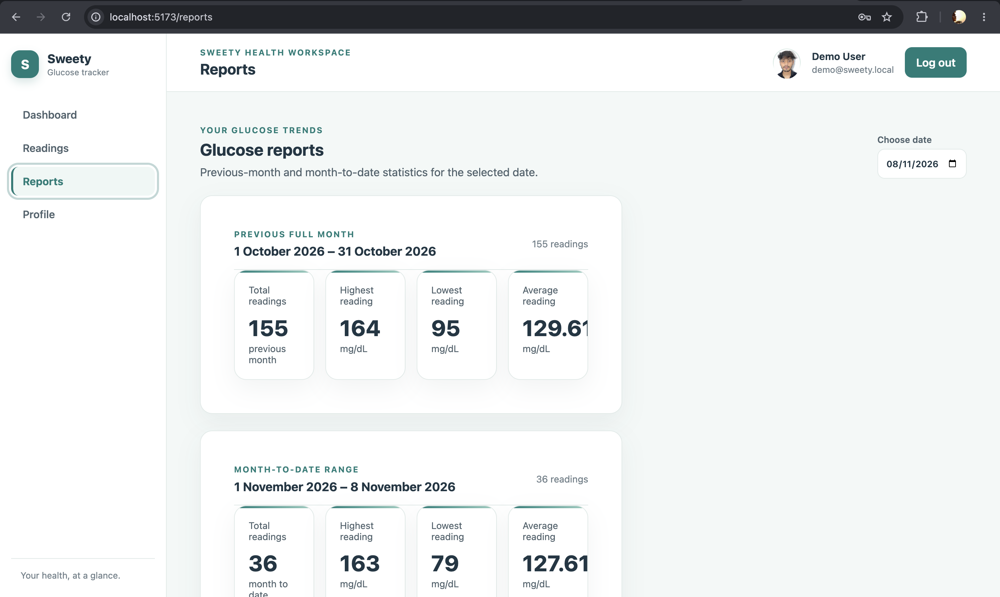
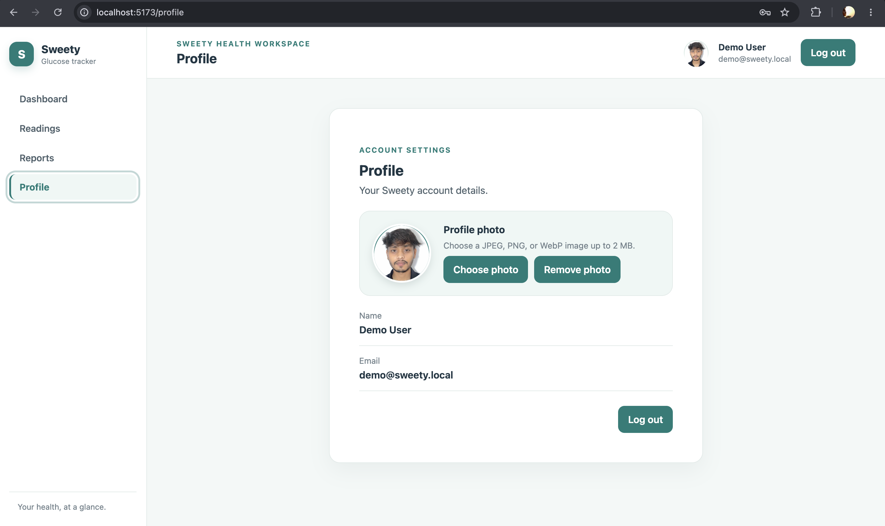

🩸 Sweety – Blood Glucose Tracker

Sweety is a full-stack Blood Glucose Tracking Application designed to help users record, manage, and monitor their blood glucose levels.

The application provides a convenient platform for maintaining glucose reading history, tracking daily and monthly progress, and managing personal health records through an intuitive interface.

🚀 Technology Stack

Frontend

* React.js
* JavaScript
* HTML5
* CSS3

Backend

* Node.js
* Express.js

Database

* PostgreSQL
* pg (Node.js PostgreSQL Client)

Authentication & Security

* JWT (JSON Web Token)
* bcrypt (Password Hashing)

✨ Key Features

* User Registration and Login
* Secure Password Hashing
* JWT-Based Authentication
* Add Blood Glucose Readings
* View Glucose Reading History
* Update and Delete Readings
* Daily Glucose Reports
* Monthly Glucose Reports
* Input Validation
* Error Handling
* Pagination for Efficient Data Retrieval
* User-Specific Data Management

🎯 Project Objectives

* Simplify blood glucose record management.
* Help users maintain historical glucose records.
* Provide daily and monthly reading summaries.
* Ensure secure authentication and data privacy.
* Deliver an easy-to-use health tracking experience.

🏗️ Architecture

Sweety follows a full-stack architecture:

* React.js handles the user interface.
* Node.js and Express.js handle backend operations and REST APIs.
* PostgreSQL stores user accounts and glucose readings.
* JWT provides secure authentication.

👨‍💻 Developer

Gourav Shukla

B.Tech – Computer Science and Engineering

📌 Project Status

Completed – Full-Stack Application

Built as a practical project to demonstrate full-stack development, REST API development, database management, authentication, and frontend-backend integration.


## 📸 Application Screenshots

### 1. Dashboard


### 2. User Profile


### 3. Blood Glucose Readings


### 4. Reports & Analytics



# Sweety — Blood Glucose Tracker

Starter workspace for a blood glucose tracking application with an Express API
and a React/Vite frontend.

## Requirements

- Node.js 20 or newer
- npm
- PostgreSQL
- A configured `DATABASE_URL` in `backend/.env`
- A strong, configured `JWT_SECRET` in `backend/.env` for login and protected API requests

## Getting started

Install dependencies in each app:

```sh
cd backend && npm install
cd ../frontend && npm install
```

Copy `backend/.env.example` to `backend/.env` and set values as needed. To
configure the frontend API URL, copy `frontend/.env.example` to `frontend/.env`.
Create the PostgreSQL database named in `DATABASE_URL` before starting the API.
On startup, the backend automatically creates the tables from
`backend/database/schema.sql` if they are missing and prints whether each
application table was created or already existed.
The example points directly to the local API; without this file, the frontend
uses `/api` through the Vite development proxy. `VITE_API_URL` is public
frontend configuration, not a place for secrets. Start the API and frontend in
separate terminals:

```sh
cd backend && npm run dev
cd frontend && npm run dev
```

The API listens on `http://localhost:5000` by default and exposes
`GET /api/health`. The frontend runs on the Vite development server and proxies
`/api` requests to the backend.

## API scaffold

- `GET /api/health`
- `POST /api/auth/signup` and `POST /api/auth/login`
- `GET /api/readings`, `POST /api/readings`, `PUT /api/readings/:id`, and `DELETE /api/readings/:id`
- `GET /api/reports?date=YYYY-MM-DD` for selected-day, month-to-date, and previous-month reports (date defaults to today)

Reports include date-wise aggregates used by the Recharts monthly glucose and
reading trend visualizations.

The protected profile page displays the signed-in user's name and email.
Logging out clears the session token and stored user details before returning
to the login page.

The frontend uses CSS media queries to adapt the dashboard, navigation,
statistics, forms, tables, and charts for desktop, laptop, tablet, and mobile
screen widths.

Reading routes require authentication and only allow users to update or delete
their own readings. The backend includes the base health endpoint, protected
auth and reading routes, and a PostgreSQL-ready schema for users and blood
glucose readings.

Run backend tests with `cd backend && npm test`.
Run frontend component and route tests with `cd frontend && npm test`.
The automated suites use mocked database queries and an in-process HTTP server;
live registration and reading persistence require a configured PostgreSQL database.

To create a fictional demo account with 670 synthetic glucose readings, run
`cd backend && npm run seed`. Sign in with `demo@sweety.local` and
`DemoPassword123!`. Each run replaces readings for this demo account; do not use
the published demo password for a real account.

The seed command applies the after-breakfast time-slot migration automatically.
To update an existing database without seeding, export `DATABASE_URL` in your
shell and run the migration from the repository root:

```sh
psql "$DATABASE_URL" -f backend/database/migrations/001_add_after_breakfast_time_slot.sql
```

New databases created from either schema file already include the updated slot.
